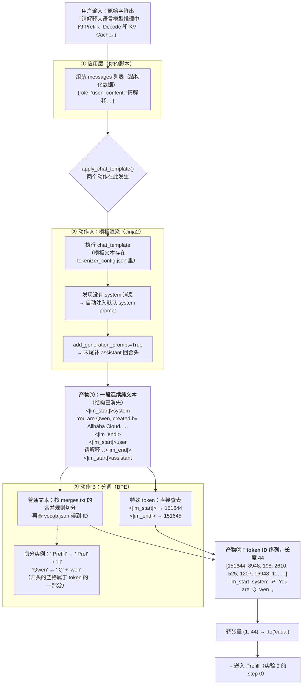

# 流水线全程实录：一个问题从输入到输出的完整旅程

> 本文是三轮问答的**逐字实录**（未做任何删改），全程使用 Qwen2.5-1.5B-Instruct + 本地 tokenizer 的**真实数据**：
> 第一轮画出输入侧流程图，第二轮逐字节走完输入侧每一步，第三轮对称走完输出侧。
> 配套概念定义见 [concepts-guide.md](./concepts-guide.md)。

---

## 第一轮：输入处理流程图

> **【提问】**
> 这里的 apply_chat_template() 同时涉及两个动作：先把消息组织成模型期望的对话格式，再转换为 Token ID。  对于这个过程我好奇 对于用户的一个问题 是如何进行处理的  请你画一个详细的流程图给我

**【回答】**

拿到了全部真实中间产物（你的问题实际被切成了 **44 个 token**，ID 序列、每枚 token 的内容都有）。下面是完整流程图 —— 每个节点里都是你这条问题的**真实数据**：



**逐步走一遍你这条问题的真实数据：**

| 步骤 | 输入形态 | 输出形态 | 你这条问题的真实产物 |
|---|---|---|---|
| ① 组装 messages | 原始字符串 | 结构化列表 | `[{role:'user', content:'请解释…'}]` |
| ② 模板渲染 | 结构化列表 | **一段纯文本** | 上面产物①那整段（含你没写过的 system prompt） |
| ③ 分词 | 纯文本 | **整数序列** | 44 个 ID，首 8 个：`151644, 8948, 198, 2610, 525, 1207, 16948, 11` |
| ④ 转张量 | 整数序列 | `(1, 44)` 张量 | 上 CUDA，成为 Prefill 的输入 |

**44 个 token 的构成**（值得盯一眼）：

```
44 = 21（system 块） + 20（user 块） + 3（assistant 回合头）
     ├─ 3 枚格式符 + 16 枚默认system文本 + 2 枚收尾
     ├─ 3 枚格式符 + 15 枚你的问题 + 2 枚收尾
     └─ <|im_start|> + assistant + \n
```

你的问题只占 **15 枚**，另外 **29 枚（约 2/3）是模板格式和隐藏 system prompt** —— 这就是为什么实验 1 值得做：用户看到的"一句话"，和模型实际处理的 44 token 之间隔着一整个流水线。

**分词细节里的三个冷知识**（都来自你这条问题的真实切分）：

1. `' Prefill'` 被切成 `' Pref' + 'ill'` 两枚 —— BPE 的合并规则取决于训练语料里子词的常见度，专业术语往往不是单枚 token；而 `' KV'`、`' Cache'` 恰好各是一枚
2. **开头的空格属于 token 的一部分**（`' Pref'` 带空格、`'Decode'` 不带）—— 所以同一个词在句首和句中可能切成不同的 token
3. 换行符 `'\n'` 自己就是一枚独立 token（ID 198）——格式控制符和文字一样都要占 token 预算

要不要我把这张流程图同步进 `experiments/concepts-guide.md` 的 1.1 节（Mermaid 在 GitHub 上原生渲染）？

---

## 第二轮：从第一个字开始逐步引导（输入侧）

> **【提问】**
> 你把这个图 完整的变化给我  比如这里的[{role:'user', content:'请解释…'}]  到底是咋样的 从最开始的用户提问开始一步步引导

**【回答】**

全部真实数据到手。现在从你敲下第一个字开始，一步步走完整条流水线 —— 每一步的下面都是**这条问题的真实数据**，不是示意。

---

### 第 0 步：用户提问 —— 一无所有的起点

你在键盘上敲出（或粘贴了）这个字符串：

```
请解释大语言模型推理中的 Prefill、Decode 和 KV Cache。
```

**此时它只是 39 个字符的 Python 字符串**。模型对它一无所知，"user"、"问题"这些概念此刻还不存在 —— 存在的只是一串文本。

---

### 第 1 步：组装 messages —— 包上"角色"结构

你的脚本（`first_inference.py:21-28`）把它放进一个列表：

```python
messages = [
    {
        "role": "user",
        "content": "请解释大语言模型推理中的 Prefill、Decode 和 KV Cache。"
    }
]
```

这就是你问的 `[{role:'user', content:'请解释…'}]` 的真身 —— **一个列表，里面一个字典**。注意两个要点：

- `role` 字段是写给**模板引擎**看的标签，模型自己永远不会看到 `"user"` 这个字段名（它只会看到渲染后的文本）
- 此刻数据还是**结构化**的：role 和 content 是分开的两个字段

---

### 第 2 步：apply_chat_template 读取模板 —— 一段 2507 字符的 Jinja2 代码

`tokenizer_config.json` 里存着 Qwen2.5 的 `chat_template`，一段 **2507 字符的 Jinja2 模板**。它是一条"文本生成程序"，对我们这条输入，真正执行到的是这四段（均为真实源码摘录）：

**① 没有 system 消息 → 注入默认值：**

```jinja

    {{- '<|im_start|>system\n' + messages[0]['content'] + '<|im_end|>\n' }}

    {{- '<|im_start|>system\nYou are Qwen, created by Alibaba Cloud. You are a helpful assistant.<|im_end|>\n' }}

```
↑ 我们走了 `else` 分支 —— 隐藏 system prompt 的出处就在这一行。

**② 遍历每条消息，套上回合格式：**

```jinja

    {{- '<|im_start|>' + message.role + '\n' + message.content + '<|im_end|>' + '\n' }}

```
↑ 你的 `role='user'` 和 `content` 在这里被拼进固定格式。

**③ 结尾按开关补 assistant 回合头：**

```jinja

    {{- '<|im_start|>assistant\n' }}

```
↑ 你传的 `add_generation_prompt=True` 命中这里。

（模板里还有 tools 工具调用、tool_response 等大段分支，我们的输入没走到，全部跳过。）

---

### 第 3 步：渲染产物 —— 结构彻底消失

Jinja2 执行完毕，输出**一段 187 字符的连续文本**（`\n` 显式标出）：

```
<|im_start|>system\nYou are Qwen, created by Alibaba Cloud. You are a helpful assistant.<|im_end|>\n<|im_start|>user\n请解释大语言模型推理中的 Prefill、Decode 和 KV Cache。<|im_end|>\n<|im_start|>assistant\n
```

三个关键认知：

- **"结构"没有了**：不再有 role 字段、不再有列表，只有一段平铺文本 —— 这就是模型视角的全部世界
- 你想单独看这一步的产物，用 `apply_chat_template(msgs, tokenize=False)` 即可
- 此刻它仍是**文本**，模型还不能吃 —— 模型只认整数

---

### 第 4 步：分词 —— 文本变成 44 个整数

BPE 分词器对上面那段文本切分，**每一枚 token 的真实 ID 和内容如下**：

**块 1 ｜ system 块（第 0–20 枚，共 21 枚）** —— 你没写过，模板注入的：

| # | ID | token | | # | ID | token |
|---|------|--------|---|---|------|--------|
| 0 | 151644 | `<\|im_start\|>` | | 11 | 14817 | ` Cloud` |
| 1 | 8948 | `system` | | 12 | 13 | `.` |
| 2 | 198 | `\n` | | 13 | 1446 | ` You` |
| 3 | 2610 | `You` | | 14 | 525 | ` are` |
| 4 | 525 | ` are` | | 15 | 264 | ` a` |
| 5 | 1207 | ` Q` | | 16 | 10950 | ` helpful` |
| 6 | 16948 | `wen` | | 17 | 17847 | ` assistant` |
| 7 | 11 | `,` | | 18 | 13 | `.` |
| 8 | 3465 | ` created` | | 19 | 151645 | `<\|im_end\|>` |
| 9 | 553 | ` by` | | 20 | 198 | `\n` |
| 10 | 54364 | ` Alibaba` | | | | |

**块 2 ｜ user 块（第 21–40 枚，共 20 枚）** —— 你的问题本体只占其中 15 枚：

| # | ID | token | | # | ID | token |
|---|------|--------|---|---|------|--------|
| 21 | 151644 | `<\|im_start\|>` | | 31 | 42588 | ` Pref` |
| 22 | 872 | `user` | | 32 | 483 | `ill` |
| 23 | 198 | `\n` | | 33 | 5373 | `、` |
| 24 | 14880 | `请` | | 34 | 32564 | `Decode` |
| 25 | 104136 | `解释` | | 35 | 58143 | ` 和` |
| 26 | 26288 | `大` | | 36 | 84648 | ` KV` |
| 27 | 102064 | `语言` | | 37 | 19479 | ` Cache` |
| 28 | 104949 | `模型` | | 38 | 1773 | `。` |
| 29 | 113272 | `推理` | | 39 | 151645 | `<\|im_end\|>` |
| 30 | 101047 | `中的` | | 40 | 198 | `\n` |

**块 3 ｜ assistant 回合头（第 41–43 枚，共 3 枚）** —— "请开始回答"的信号：

| # | ID | token |
|---|------|--------|
| 41 | 151644 | `<\|im_start\|>` |
| 42 | 77091 | `assistant` |
| 43 | 198 | `\n` |

对着这张表能读出的四个细节：

1. **`Qwen` 自己都被切成 `' Q' + 'wen'`**（第 5、6 枚）—— 专有名词在 BPE 里不一定有整token；而 `' KV'`、`' Cache'` 恰好是单枚
2. **` Prefill` → `' Pref' + 'ill'`**（第 31、32 枚）—— 且空格属于 token 的一部分，所以句中词和句首词切法可能不同
3. **`\n`（ID 198）出现了 5 次**（第 2、20、23、40、43 枚）—— 格式控制符和文字一样占 token 预算
4. **特殊 token 的 ID 特别大**（151644/151645 排在词表尾部，属于后加的 added tokens）；常用词 ID 小（`You`=2610）—— 词表大体按训练语料频率排布

---

### 第 5 步：转张量 —— 拿到模型的"饭"

```python
inputs = tokenizer.apply_chat_template(
    messages, tokenize=True, add_generation_prompt=True, return_tensors="pt"
).to("cuda")

# inputs 的真身：
# tensor([[151644, 8948, 198, 2610, 525, 1207, 16948, 11, 3465, 553, ...]],
#        device='cuda:0')          ← 形状 (1, 44)，dtype int64
```

**39 字符的问题 → 187 字符的渲染文本 → 44 个整数 → 1×44 的 GPU 张量。**

---

### 第 6 步：交接给 Prefill

这个 `(1, 44)` 张量就是实验 9 里 `step 0 | input 40+ tok` 那一步的输入 —— Prefill 把 44 个 ID 查表变成 44 个向量，并行过完 28 层 transformer，产出第 45 个 token（也就是回答的第一个字）和满满的 KV Cache。那是另一条流水线的故事了。

---

**一句话总括这条流水线**：*字符串 → 结构化消息 →（模板程序渲染）→ 单段文本 →（BPE 查表）→ 整数序列 → 张量*。每一步都是纯确定性的"翻译"，没有魔法 —— 魔法（模型的理解）从 Prefill 才开始。

需要的话我把这份完整 walkthrough + 上一条 Mermaid 图一起同步进 `concepts-guide.md` 的 1.1 节。

---

## 第三轮：输出侧对称实录（从模型喉咙到人眼）

> **【提问】**
> 然后你把生成的输出的过程（我们人眼适合看的）再这样详细的展示

**【回答】**

真实数据全部到手（这次生成恰好**被截断在 48 枚、没到 `<|im_end|>`** —— 意外复现了实验 2 的场景，第 5 步会用到这个巧合）。现在从模型"喉咙里"的第一个数开始，走到你眼睛看到文字为止：

---

### 第 0 步：模型的原始输出 —— 一个 151,936 维的概率分布，不是文字

Prefill 把 44 枚 token 过完 28 层 transformer 后，最后一格输出的不是"一个词"，而是**全词表 151,936 个候选各自的概率**（`out.logits[0, -1]`，softmax 后）。真实分布的前五名：

| 排名 | ID | token | 概率 |
|---|------|--------|------|
| 1 | 18493 | `在` | **74.77%** |
| 2 | 26288 | `大` | 14.72% |
| 3 | 29978 | `Pref` | 4.78% |
| 4 | 103942 | `当然` | 0.83% |
| 5 | 98841 | `预` | 0.39% |
| …… | …… | 其余 151,931 个候选 | 合计 ~4.4% |

**这就是模型"思考"的真身**：它对"回答该以哪个字开头"的完整意见。此刻还没有任何文字被"生成"。

---

### 第 1 步：挑 token —— 从分布压到 1 个整数

```python
next_id = int(out.logits[0, -1].argmax())   # 贪心：拿走概率冠军
# → 18493
```

- 贪心：永远拿冠军 → `18493`（`在`）
- 采样（实验 5~8）：按这份分布掷骰子 —— 74.77% 的概率还是落在 `在`，但 48 枚里偶尔会摇中 `大` 或 `当然`，于是每次运行不同
- 引擎随即做停止检查（实验 4 的纪律）：`18493` 不是 eos → 继续

---

### 第 2 步：Decode 循环 —— 48 枚 token 逐个累积（真实全表）

每一步重复"喂上一枚 → 查缓存 → 出分布 → 挑一枚"。这次运行真实产出的 48 枚：

| # | ID | token | | # | ID | token | | # | ID | token |
|---|------|--------|---|---|------|--------|---|---|------|--------|
| 0 | 18493 | `在` | | 16 | 101124 | `三个` | | 32 | 104949 | `模型` |
| 1 | 26288 | `大` | | 17 | 100799 | `重要的` | | 33 | 36993 | `会` |
| 2 | 102064 | `语言` | | 18 | 101290 | `概念` | | 34 | 116976 | `预先` |
| 3 | 104949 | `模型` | | 19 | 3407 | `。\n\n` | | 35 | 115424 | `填充` |
| 4 | 9370 | `的` | | 20 | 16 | `1` | | 36 | 101883 | `一些` |
| 5 | 113272 | `推理` | | 21 | 13 | `.` | | 37 | 20074 | `数据` |
| 6 | 101925 | `过程中` | | 22 | 42588 | ` Pref` | | 38 | 26939 | `到` |
| 7 | 3837 | `，` | | 23 | 483 | `ill` | | 39 | 111390 | `内存` |
| 8 | 29978 | `Pref` | | 24 | 5122 | `：` | | 40 | 15946 | `中` |
| 9 | 483 | `ill` | | 25 | 100346 | `这是` | | 41 | 1773 | `。` |
| 10 | 5373 | `、` | | 26 | 63367 | `指` | | 42 | 100001 | `这些` |
| 11 | 32564 | `Decode` | | 27 | 18493 | `在` | | 43 | 20074 | `数据` |
| 12 | 33108 | `和` | | 28 | 113272 | `推理` | | 44 | 102119 | `通常` |
| 13 | 82707 | `KV` | | 29 | 55286 | `开始` | | 45 | 100630 | `包括` |
| 14 | 19479 | ` Cache` | | 30 | 101056 | `之前` | | 46 | 110376 | `词汇` |
| 15 | 20412 | `是` | | 31 | 3837 | `，` | | 47 | 20742 | `表` |

对着表能读出四个真细节：

1. **第 8 枚 `Pref`（ID 29978）和第 22 枚 ` Pref`（ID 42588）是两个不同的 token** —— 同一个词，前面有没有空格，ID 就不同。这正好解释了输入侧看到的"空格属于 token 的一部分"
2. **第 19 枚 `。\n\n` 是一枚 token** —— 句号加两个换行打包出售；第 20、21 枚 `1`、`.` 则是 markdown 编号的开始
3. **第 27 枚 `在` 又是 18493** —— 和第 0 枚一模一样：同一个字无论出现在哪，ID 恒定（这是"查表"能工作的前提）
4. 48 枚里**没有出现任何特殊 token** —— 伏笔，第 5 步揭晓

---

### 第 3 步：完整序列 —— 模型侧的"总账本"

```python
outputs = model.generate(inputs, max_new_tokens=48, do_sample=False, ...)

outputs.shape          # torch.Size([1, 92])  ← 44（prompt）+ 48（新增）
outputs[0][:4]         # tensor([151644, 8948, 198, 2610])  ← 你的输入在开头
outputs[0][-3:]        # tensor([110376, 20742]) 等新增部分
```

这就是实验 3 看到的真相：generate 交还的是**输入和输出拼在一起的整条序列**。

---

### 第 4 步：切片 —— 摘掉 prompt（实验 3 的那一行）

```python
answer_tokens = outputs[0][inputs.shape[-1]:]   # [44:] → 只剩那 48 枚
```

纯下标操作，零智能 —— 因为 prompt 长度是已知的（44），一刀切下去必然干净。

---

### 第 5 步：decode —— 反向查表拼字符串

```python
tokenizer.decode(answer_tokens, skip_special_tokens=False)
tokenizer.decode(answer_tokens, skip_special_tokens=True)
```

这次运行的**真实结果：两个输出一字不差**。为什么（回顾实验 2）：

- 这次 48 枚跑满了预算、**被截断**，新增部分从头到尾没出现 `<|im_end|>`
- skip 开关只过滤**特殊 token** —— 序列里没有，两个开关自然等价
- 如果模型自然说完（像最早 256 token 那次），skip=False 的结尾会多一个 `<|im_end|>`，skip=True 则没有

关键认知：**decode 不参与生成**。它只是"ID → 字符串"的查表拼接（vocab.json 反着用），模型在此刻早已退场。

---

### 第 6 步：人眼看到的

```python
print(answer)
```

屏幕上出现：

> 在大语言模型的推理过程中，Prefill、Decode和KV Cache是三个重要的概念。
>
> 1. Prefill：这是指在推理开始之前，模型会预先填充一些数据到内存中。这些数据通常包括词汇表

（被截断在"词汇表"处 —— 没说完，也没 `<|im_end|>`，和实验 2 的判据完全吻合。如果你的界面渲染 markdown，`1.` 还会变成列表项 —— 那是**展示层**的最后一步加工，与模型无关。）

---

### 两条流水线对照（一进一出，完全对称的"翻译"链）

```
输入侧：字符串 → messages结构 → 模板渲染 → BPE切分 → 44个整数 → 张量 → [Prefill]
输出侧：[分布151936浮点] → 挑1个整数 → 循环累积48枚 → 切片[44:] → 反查表拼接 → 屏幕文字
         ↑ 第0步              ↑ 第1-2步      ↑ 第3步      ↑ 第4步      ↑ 第5步      ↑ 第6步
```

**模型的世界里只有整数进出**：进去 44 个，出来 48 个；文字是人类两侧的"化妆品"。输入侧的模板和BPE是化妆上台，输出侧的切片和decode是卸妆谢幕。

要把这份输出侧 walkthrough（连同上一条输入侧的）一起同步进 `concepts-guide.md` 吗？

---

[← 返回总览](../README.md)
