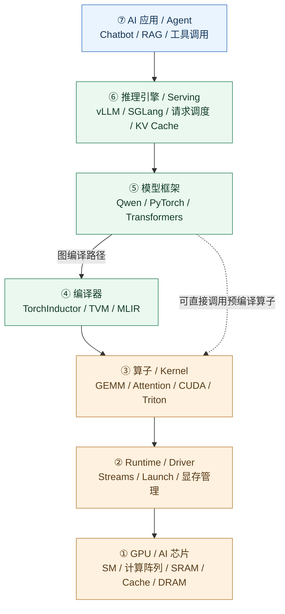
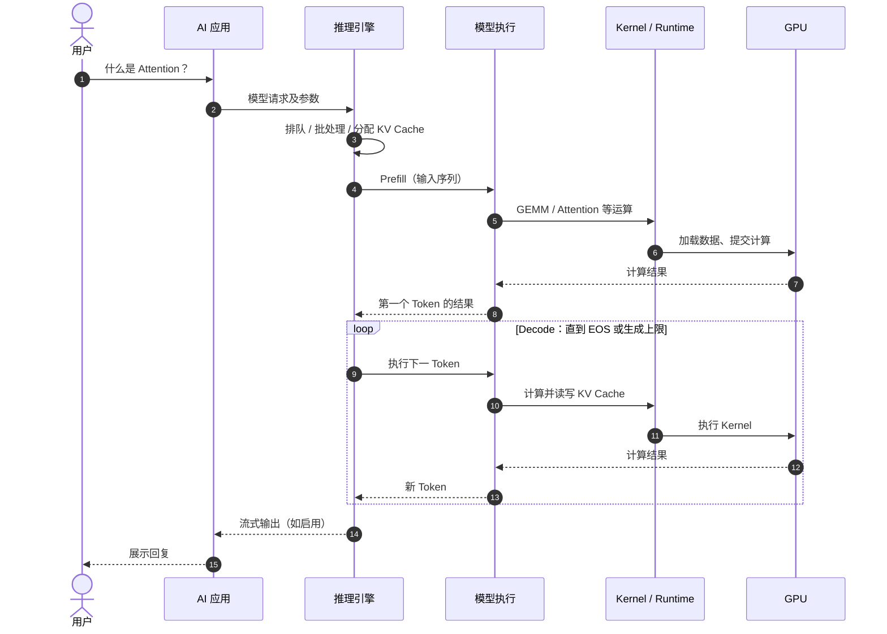
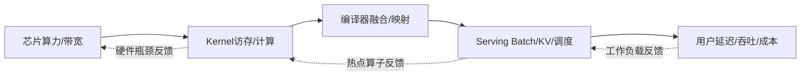
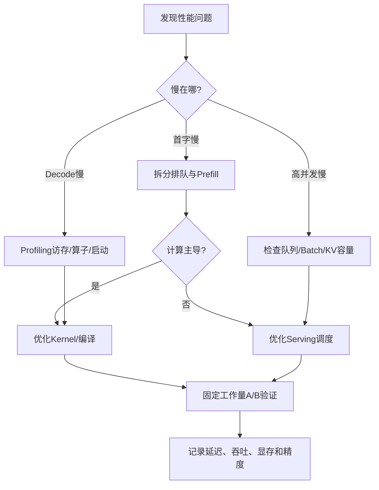

# 从芯片底层到 AI Infra：计算系统地图

> 以 RTX 4090 运行 Qwen2.5-1.5B-Instruct 为例，理解 **AI 应用 → 推理引擎 → 模型框架 → 编译器 → Kernel → Runtime → 芯片** 的关系。
>
> 本文属于概念梳理和思维实验，不将假设场景视为实际 Benchmark；相关实测请参见仓库中的 [实验 9](./experiments/experiment-09.md) 和 [实验 11](./experiments/experiment-11.md)。

## 一、动态演示：一条 AI 请求是怎样到达芯片的？

**核心观点：芯片提供物理计算能力；算子与编译器决定如何使用硬件；推理引擎负责组织模型执行和请求；AI 应用负责把能力交付给用户。**

### 1.1 分层架构图



**阅读方式：**
- 请求从上向下传递，最终在芯片上执行；性能影响可以从下向上传递到用户体验。
- 这是一张**逻辑分层图**，不是严格、唯一的运行顺序。Runtime/Driver 为多个层次提供服务，不同 Serving 系统也可能绕开普通 PyTorch 前向过程直接调用专用 Kernel。
- 图编译不是每条路径的必经步骤：有些算子是编译生成的，有些来自预编译库。

### 1.2 一条“什么是 Attention？”请求的执行时序



### 1.3 七个逐层展开的步骤

<details><summary><b>步骤 1｜应用 / Agent：业务层</b></summary>

接收用户问题，组织 Prompt、RAG 检索和工具调用。关注业务工作流、用户体验和请求路由。典型岗位：Agent 应用工程师。

</details>

<details><summary><b>步骤 2｜Serving：推理引擎</b></summary>

vLLM/SGLang 等负责请求排队、Continuous Batching、Prefill/Decode 调度和 KV Cache 分配。关注 TTFT、TPOT、吞吐与尾延迟。典型岗位：LLM Infra / 推理引擎工程师。

</details>

<details><summary><b>步骤 3｜模型框架：组织张量计算</b></summary>

模型通过 Embedding、QKV 投影、Attention、MLP 和 Logits 等运算生成结果。关注模型结构、量化、张量布局和执行路径。典型岗位：模型算法、模型部署与框架研发。

</details>

<details><summary><b>步骤 4｜编译器：将运算映射到目标芯片</b></summary>

在相应编译路径中执行 IR 变换、算子融合、Tiling、代码生成和自动调优。常见技术：TorchInductor、TVM、MLIR。注意：不是所有算子都需要走同一个图编译流程。

</details>

<details><summary><b>步骤 5｜Kernel：执行一次具体计算</b></summary>

负责 GEMM、Softmax、Attention 等底层计算。常见优化：访存合并、数据复用、共享内存、Tiling、融合、Warp 占用。NVIDIA 平台常见工具：CUDA、Triton。

</details>

<details><summary><b>步骤 6｜Runtime / Driver：连接程序与设备</b></summary>

管理设备内存、执行流、Kernel 启动和同步等。典型问题：启动开销、资源调度和异步执行。

</details>

<details><summary><b>步骤 7｜GPU / AI 芯片：物理计算基础</b></summary>

计算阵列执行指令，寄存器、片上 SRAM/Cache 和 DRAM 负责数据供给。优化方向：算力、带宽、能效、片上存储、互联和芯片架构。

</details>

---

## 二、最关键的问题：芯片优化和 AI Infra 优化究竟有什么不同？

### 2.1 一个类比

- **芯片**：发动机及车辆的物理性能上限。
- **算子 / 编译器**：传动系统与驾驶方式，决定能否高效利用车辆。
- **推理引擎**：车队调度，决定任务如何排队、拼单、分配车辆。
- **平台 Infra**：运输网络的运营体系，负责扩容、可靠性和成本。

**发动机性能翻倍，不等于物流系统吞吐翻倍。** 如果瓶颈在排队、存储或道路，改善发动机的收益可能很小。

### 2.2 各层职责和衡量指标

| 优化层级 | 核心问题 | 常见技术 | 衡量指标 |
|---|---|---|---|
| 芯片架构 | 怎样设计计算单元、存储和互联？ | 计算阵列、SRAM、带宽、NoC | 峰值算力、带宽、能效 |
| Kernel | 一次算子怎样更快？ | CUDA、Triton、Tiling、Fusion | Kernel 延迟、有效带宽、利用率 |
| 编译器 | 运算怎样转换为高效可执行程序？ | TorchInductor、TVM、MLIR | 图执行性能、编译开销 |
| Runtime | 怎样安排执行和资源？ | Streams、内存分配、Kernel Launch | 启动与同步开销 |
| Serving | 怎样同时服务大量请求？ | vLLM、SGLang、Batching、KV Cache | TTFT、TPOT、Tokens/s、P95/P99 |
| AI 平台 | 怎样让多机、多模型服务稳定运行？ | Kubernetes、Ray、监控、弹性扩容 | 可用性、成本、资源利用率 |

**术语边界：** AI Infra 是广义概念，可涵盖推理/训练框架、算子、编译器、分布式调度与部署平台；RTL、数字电路和微架构设计则更直接属于硬件研发。它们相互联系，但不能完全等同。

### 2.3 跨层优化如何发生？



需要辨认瓶颈类型：

1. **Compute-bound（算力受限）**：计算资源接近饱和；减少 FLOPs 或提高计算效率更有价值。
2. **Memory-bound（访存受限）**：算子大部分时间等待数据；减少搬运、提高复用或有效带宽更重要。
3. **Launch/Scheduling-bound（启动或调度受限）**：排队、同步和 Kernel 启动占比明显；只增加算术吞吐未必有用。

### 2.4 为什么局部加速不等于整体加速？——Amdahl 定律

假设一次请求原本耗时 **100 ms**：热点 Kernel 30 ms，其他环节 70 ms。将热点 Kernel **加速 2 倍**：

```text
优化前：30 + 70 = 100 ms
优化后：15 + 70 =  85 ms
端到端加速：100 / 85 ≈ 1.18×
```

这个数字仅为解释原理的**假设**，不是实测。若瓶颈在队列中，即使某个 Kernel 更快，用户体验也可能几乎不变。

---

## 三、交互实验：为什么芯片变快不等于推理系统一定变快？

> **使用方法**：先根据场景猜瓶颈，再展开查看分析。GitHub Markdown 支持下面的折叠面板，但不执行自定义 JavaScript。

<details>
<summary><b>场景 A｜长 Prompt：为什么第一个字迟迟不出现？</b></summary>

**现象**：输入几千个 Token，TTFT 很长。

**可能原因**：Prefill 的矩阵计算 / Attention 开销高，也可能排队时间过长、前缀未命中缓存或调度策略不适合长输入。

**底层手段**：GEMM/Attention Kernel、融合、数据复用、计算效率和访存优化。

**上层手段**：Prefix Caching（存在共享前缀时）、Chunked Prefill、Prefill 调度。

**测量**：将 **TTFT 拆分为排队、预处理、Prefill 执行等阶段**。若计算为瓶颈则先优化 Kernel；若排队为瓶颈则先优化 Serving。

</details>

<details>
<summary><b>场景 B｜单用户 Decode：为什么逐字生成很慢？</b></summary>

**现象**：只有一个用户，输出阶段每个 Token 都比较慢。

**可能原因**：小 Batch Decode 常常需要不断读取大量权重，显存带宽可能占主导；也可能受 KV Cache 访问、Kernel Launch、同步等影响。

**底层手段**：访存布局、融合、减少权重读取量（例如合适的量化）、专用 Attention Kernel。

**上层手段**：缓存管理与执行开销优化。增大 Batch 可能提高总体吞吐，但不保证单用户 TPOT 降低。

**测量**：TPOT、单用户 Tokens/s、带宽利用率、Kernel 时间占比。

**与仓库实测对照**：[实验 11](./experiments/experiment-11.md) 中，在 Qwen2.5-1.5B、Batch=1、指定序列长度与环境下，开启 / 关闭 KV Cache 的固定工作量 A/B 测试中位结果约 **0.998×，无明显性能差异**。这是特定负载下的结果，不能推广为“KV Cache 没用”；也不能一概断言“打开缓存就一定显著加速”。

</details>

<details>
<summary><b>场景 C｜高并发：一个用户很快，100 人一起访问就慢？</b></summary>

**现象**：单请求测试正常，高并发时排队明显、P95/P99 延迟上升、KV Cache 占满显存。

**可能原因**：调度、KV 容量、Batch 组成、Prefill/Decode 资源争抢，或者设备真实吞吐已经饱和。

**底层手段**：提升热点 Attention/GEMM Kernel 的执行效率，降低每 Token 计算和访存开销。

**上层手段**：Continuous Batching、Paged KV、Admission Control、请求优先级、跨实例/多卡调度。

**测量**：系统总 Tokens/s、排队耗时、P50/P95/P99、GPU 使用率和显存占用。

**结论**：这类场景尤其需要看 Serving；一个 Kernel 快 2 倍不代表整个服务吞吐能提高 2 倍。

</details>

### 3.1 三类负载的快速判断表

| 场景 | 优先测量 | 可能瓶颈 | 首选排查层 |
|---|---|---|---|
| 首字慢 / 长 Prompt | TTFT，排队与 Prefill 时间 | Attention/GEMM 或调度 | Kernel + Serving |
| 单用户逐字慢 | TPOT、带宽、Kernel Profile | 权重读取、KV 访问、Launch | Kernel + Runtime |
| 高并发尾延迟高 | 吞吐、排队、P95/P99 | 调度、KV 容量、设备饱和 | Serving + 平台 |

### 3.2 如何将思维实验变成可信 Benchmark？

参考仓库 [实验 10](./experiments/experiment-10.md) 和 [实验 11](./experiments/experiment-11.md) 的方法论：

1. **固定工作量**：同一模型、精度、输入、输出长度、Batch 与并发；避免 EOS 导致对比组工作量不同。
2. **记录环境**：GPU、驱动、CUDA、PyTorch、Serving 版本以及设备温度、其他进程占用。
3. **预热并重复**：交替运行 A/B，多轮记录中位数和离散程度，避免用单次最快值下结论。
4. **正确计时**：GPU 是异步执行的，必要时使用 CUDA Events / 同步；明确是否计入 CPU 和网络开销。
5. **区分层级指标**：Kernel latency、端到端 TTFT/TPOT、系统吞吐、显存和模型精度需要分别报告。
6. **先 Profiling 再优化**：找到瓶颈 → 设计单变量实验 → 验证正确性 → 比较加速效果 → 复测真实业务负载。



### 3.3 下一步学习路线

从当前 Qwen2.5-1.5B + RTX 4090 的学习基础出发：

- **向上**：部署 vLLM/SGLang，对比 Hugging Face Eager 推理；测 TTFT、TPOT、吞吐和显存。
- **向下**：用 Triton/CUDA 实现 Softmax/LayerNorm，再对比 PyTorch 基线并做 Profiling。
- **继续深入**：学习 SM、Warp、SRAM/Cache、GDDR 带宽与编译器 Tiling/融合。
- **形成闭环**：识别瓶颈 → 解释机制 → 优化 → 受控验证 → 写实验复盘。

**最后一句话：芯片底层研究“如何让一次计算更高效”，Serving/AI Infra 研究“如何让大量计算任务组成高效系统”；真正的系统能力来自跨层瓶颈分析。**

---

## 延伸阅读

### 仓库内学习资料

- [核心概念详解](./experiments/concepts-guide.md)
- [推理流水线实录](./experiments/pipeline-walkthrough.md)
- [实验 9：Prefill / Decode / KV Cache](./experiments/experiment-09.md)
- [实验 11：固定工作量 KV Cache A/B](./experiments/experiment-11.md)

### 官方技术资料

- [CUDA C++ Programming Guide](https://docs.nvidia.com/cuda/cuda-c-programming-guide/index.html)
- [Triton Tutorials](https://triton-lang.org/main/getting-started/tutorials/index.html)
- [PyTorch torch.compile](https://docs.pytorch.org/docs/stable/generated/torch.compile.html)
- [vLLM Documentation](https://docs.vllm.ai/en/latest/)
- [SGLang Documentation](https://docs.sglang.ai/)
